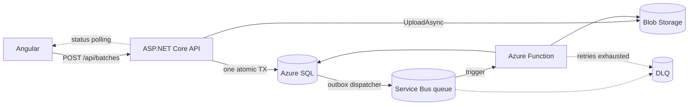

# Payroll Processing System

A cloud-native payroll file processing system built with **ASP.NET Core**, **Azure Functions (.NET isolated worker)**, **Angular**, and **Microsoft Azure**.

Built as a hands-on cloud architecture project — authentication and authorization are deliberately deferred to a later phase.

---

## ⚠️ Project updates (29 Oct 2026)

Three corrections to the original brief, verified against Microsoft's official sources:

1. **AZ-204 was retired on 31 July 2026.** It cannot be sat at any price. The certification-mapping section of the original brief is therefore **dropped** — this is a pure engineering project, as you specified.
2. **.NET 9 reaches end-of-support on 10 Nov 2026.** Project targets **.NET 10 (LTS → Nov 2028)**.
3. **Region selected: East US**, chosen from live Azure Retail Prices API data as cheapest for this workload's SKUs.

---

## Repository layout

```
Payroll System/
├── docs/
│   ├── PHASE_ZERO.md        Azure account, region evidence, budgets, idle costs, cleanup
│   ├── ARCHITECTURE.md      diagrams, resource inventory, responsibilities, failure matrix
│   └── PLAN.md              build phases with tasks + acceptance criteria
├── src/
│   ├── Payroll.Api/         ASP.NET Core Web API
│   ├── Payroll.Functions/   Azure Functions — isolated worker, Service Bus trigger
│   └── Payroll.Shared/      Contracts, message schemas, shared enums
├── client/                  Angular dashboard
├── infra/                   Bicep infrastructure-as-code
├── tests/                   Unit + integration tests
└── local/                   Docker Compose + emulator configuration
```

---

## Architecture (summary)



**The key invariant:** Blob Storage publishes nothing. The API is the only writer of control-plane state. Every message is published explicitly by the outbox dispatcher *after* a single atomic database commit.

Full detail, sequence diagram, deployment diagram, resource inventory, and the 14-scenario failure matrix: [`docs/ARCHITECTURE.md`](docs/ARCHITECTURE.md).

---

## Cost target

| Component | SKU | Monthly |
|---|---|---|
| Azure SQL Database | Basic DTU (5) | **$4.89** |
| Service Bus namespace | Basic | ~$0.05 |
| Storage account | Standard LRS | ~$0.03 |
| App Service (API) | Free F1 | $0 |
| Function App | Consumption Y1 | $0 (within grant) |
| Static Web App (Angular) | Free | $0 |
| Application Insights | Free tier | $0 (within grant) |
| **Total** | | **≈ $4.97/mo** |

Against a **$100 / 12-month** Azure for Students credit → ~$60/year with ~$40 headroom.

Local development runs against **Azurite**, a **SQL Server 2022 container**, and the **official Service Bus emulator v2** — near-zero cloud spend until the deployment phase.

---

## Prerequisites

```powershell
# REQUIRED — .NET 9 goes EOL 10 Nov 2026
winget install Microsoft.DotNet.SDK.10

# Tooling
winget install Microsoft.AzureCLI
npm i -g azure-functions-core-tools@4 --unsafe-perm true
npm i -g azurite
npm i -g @angular/cli
```

Verified present: Node 22.19, npm 11.11, Angular CLI, Docker 28.0.4.

---

## Getting started

```powershell
# 1. Start local dependencies
docker compose -f local/docker-compose.yml up -d

# 2. Run the API
dotnet build
dotnet run --project src/Payroll.Api

# 3. Run the Function app
func start --script-root src/Payroll.Functions

# 4. Run the dashboard
cd client && npm start
```

---

## Development standards

ASP.NET Core Web API · EF Core with migrations · DTOs + validation consistency · async/await throughout · structured logging · environment-specific configuration · OpenAPI · health checks · correlation IDs · idempotent message processing · Bicep IaC · GitHub Actions CI/CD · unit + integration tests.