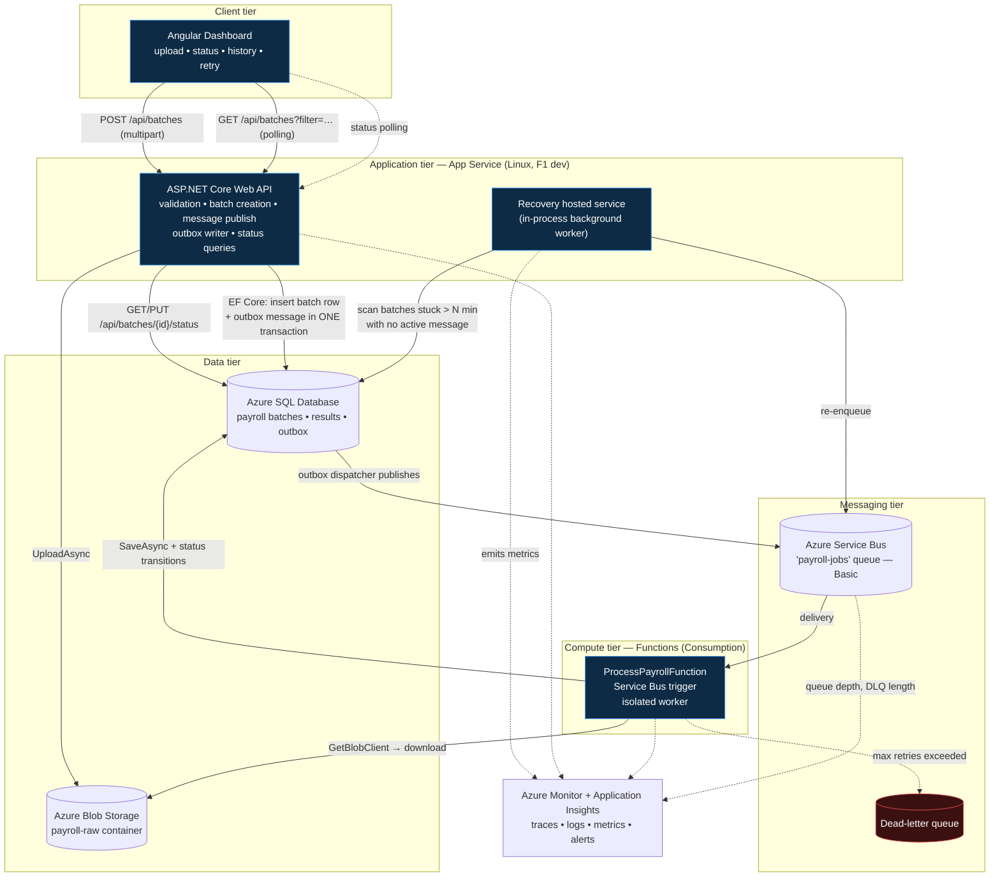
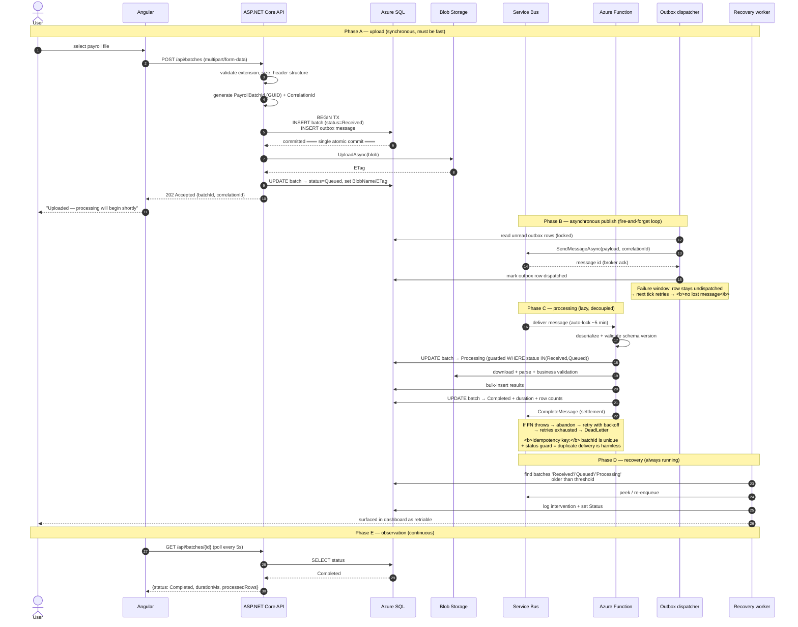
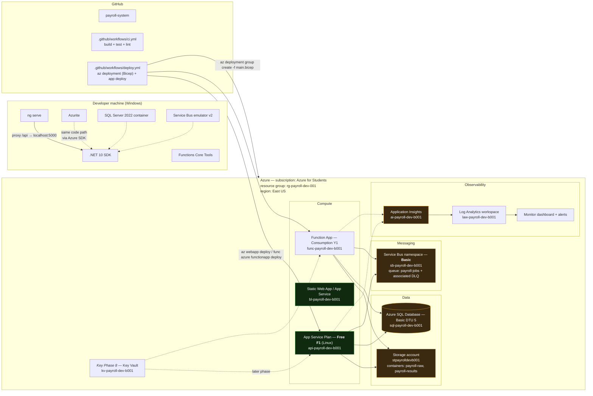
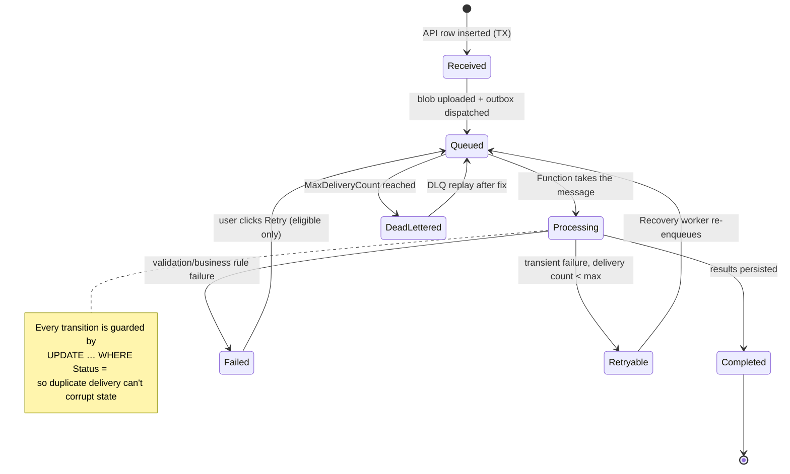

# Architecture — Payroll Processing System

> Design principle for this project: **the API is the only writer of control-plane state.**
> Blob Storage stores bytes; it publishes nothing. Every message is published *explicitly* by
> application code after the durable state is committed.

---

## 1. Corrected high-level architecture

Your original diagram had one misleading edge: it drew Blob Storage → Service Bus, implying an
automatic handoff. Azure has no such implicit link. Below, the publish is explicitly owned by the
API, and the recovery worker is shown as a first-class path rather than an afterthought.



**What changed relative to your diagram, and why:**

| Change | Reason |
|---|---|
| Removed the Blob → Service Bus edge | Blob Storage cannot publish to Service Bus on its own. (It *can* emit **Event Grid** events on blob create — that is a deliberate alternative design we rejected for v1, see §7.) |
| Added **API → SQLite/SQL outbox → Service Bus** | Makes the atomic-commit + async-publish sequence explicit, and shows where the reliability gap lives. |
| Added **DLQ** as a terminal node | A queue without a DLQ strategy silently drops poison messages. |
| Added **Recovery worker** | The one branch that guarantees a batch can never be permanently stuck. |
| Added **Observability** as an attached layer, not an inline hop | Telemetry is a cross-cutting concern; drawing it inline implies it's part of the happy path. |

---

## 2. Payroll processing sequence



---

## 3. Deployment architecture



Legend: 🟩 **$0** — 🟨 **metered** (contributes to the ~$5/mo committed scenario).

---

## 4. Azure resource inventory

| # | Resource | Type | SKU | Region | Idle cost | Purpose |
|---|---|---|---|---|---|---|
| 1 | `rg-payroll-dev-001` | Resource Group | — | East US | **$0** | Lifecycle + cost boundary for everything below |
| 2 | `stpayrolldevb001` | Storage account (v2) | Standard LRS | East US | ~$0.03 | Blob storage for uploaded payroll files |
| 3 | `sql-payroll-dev-b001` | Azure SQL Database | **Basic DTU** (5 DTU, 2 GB) | East US | **$4.89/mo** | Batches, statuses, results, outbox |
| 4 | `sb-payroll-dev-b001` | Service Bus namespace | **Basic** | East US | ~$0.05/mo | `payroll-jobs` queue + DLQ |
| 5 | `func-payroll-dev-b001` | Function App | **Consumption Y1** | East US | $0 in free grant | Service Bus–triggered processor |
| 6 | `app-payroll-dev-b001` | App Service Plan + Web App | **Free F1 (Linux)** | East US | **$0** | Hosts ASP.NET Core API |
| 7 | `swa-payroll-dev-b001` | Static Web App | **Free** | East US | **$0** | Hosts Angular build *(alt: F1 App Service)* |
| 8 | `ai-payroll-dev-b001` | Application Insights | Free tier | — | $0 within quota | Traces, requests, dependencies, exceptions |
| 9 | `law-payroll-dev-b001` | Log Analytics workspace | Free 30-day grant | East US | $0 within grant | KQL queries, alert rules |
| 10 | `kv-payroll-dev-b001` | Key Vault | Standard | East US | ~$0.02/mo | **Phase 8 only** — secrets & connection strings |
| 11 | *(optional)* `redis-…` | Azure Managed Redis | **Free tier** | East US | **$0** | **Phase 5 only** — *if and only if* we measure a benefit |

**Committed scenario totals ≈ $4.97/month** (SQL $4.89 + Service Bus $0.05 + storage ~$0.03).
Everything else is $0 or within free-tier grants.

### Entities to create in Service Bus (Basic tier)

```text
namespace  sb-payroll-dev-b001        (Basic)
└── queue   payroll-jobs
      ├── LockDuration            PT1M
      ├── MaxDeliveryCount        5
      ├── DeadLetteringOnMessageExpiration  true
      ├── RequiresSession         false
      └── DefaultMessageTimeToLive  P14D
```

> ⚠️ **Basic tier supports queues only** — it does **not** support topics, subscriptions,
> sessions, or scheduled enqueue with arbitrary delay. That is precisely why Basic is $0.05 and
> Standard is $10. If we later need fan-out (multiple independent subscribers), that is the moment
> to move to Standard — and we should do it with a documented cost justification.

---

## 5. Component responsibilities

| Component | Owns | Must never do |
|---|---|---|
| **Angular** | File selection & progress, rendering batch list/status/history, error surfacing, retry intent, displaying `CorrelationId` | Hold secrets, decide business rules, directly touch Azure |
| **ASP.NET Core API** | Input validation, GUID generation, **the single atomic DB commit**, blob upload, outbox insert, read-only status queries | Long-running work, parse payroll files inline, publish directly via fire-and-forget |
| **Outbox dispatcher** | Turning committed DB rows into Service Bus messages, retry with backoff | Skip the DB, lose the message if publish fails |
| **Azure Function** | Download, parse, validate, compute, persist results, transition statuses, record duration | Publish new work without TTL guard, assume exactly-once delivery |
| **Recovery worker** | Detecting stuck batches, re-enqueueing, recording interventions | Retry without a backoff ceiling, silently "fix" a legitimately failed batch |
| **Blob Storage** | Durable bytes only | Publish anything, enforce business rules |
| **Service Bus** | Durable buffering, DLQ, delivery guarantees, lock semantics | Understand payload contents, run business logic |
| **Azure SQL** | System of record: batch state machine, results, outbox | — |
| **App Insights / Monitor** | Correlation across every hop, metrics, alerts | Hold payloads or PII in telemetry |

### Batch state machine



---

## 6. Failure scenarios and recovery strategies

This is the section that determines whether the system is *actually* correct, versus merely
passing the happy path.

| # | Failure point | Symptom | Impact | Recovery strategy |
|---|---|---|---|---|
| **F1** | **DB commit succeeds, blob upload fails** | Batch row `Received`, no blob | Orphan row, never processed | Recovery sees `Received` older than N min → attempts upload retry from a temp copy, or marks `Failed` with reason. Never reaches `Queued`. |
| **F2** | **Blob uploaded, then DB status update fails** | Blob exists, row still `Received` | Same as F1 | Idempotent re-upload (same batchId path) is safe — overwrite with same content. |
| **F3** | **Outbox row committed, dispatcher crashes** | Row undispatched | Message delayed, **not lost** | Ticker re-scans undispatched rows → publishes → marks dispatched. Base of the outbox guarantee. |
| **F4** | **Publish succeeds, DB mark-dispatched fails** | Message published *and* row still undispatched | **Duplicate message** | Function is **idempotent**: unique batchId + status guard makes duplicate delivery harmless. Get this wrong and you double-insert payroll rows. |
| **F5** | **Function crashes mid-processing** | Message abandoned, lock expires | Retry after lock but **before** lock-duration timeout | Status guard (`Queued/Processing → Processing`) + results written in a transaction. If lock expires, another instance takes over safely. |
| **F6** | **Retryable failure escaping retryable exception type** | Nothing retries | **Batch stuck silently** | Recovery worker: `Processing` older than threshold → re-enqueue or mark Failed with diagnostics. Backstop for F1–F5. |
| **F7** | **Poison message (unparseable, wrong schema version)** | Repeats forever | Queue clogging, throttling | `MaxDeliveryCount=5` → **auto-dead-letter**. DLQ length is a monitored metric with an alert. |
| **F8** | **Service Bus unavailable at publish time** | Dispatcher throws | Outbox rows accumulate | Retry with exponential backoff + jitter. Rows persist in SQL, so burst recovery is automatic when Service Bus returns. |
| **F9** | **Service Bus unavailable at consume time** | Function can't receive | Queue depth grows | Messages are durable; they replay on reconnect. Alert on queue depth > threshold. |
| **F10** | **SQL unavailable during processing** | Function transaction fails | Retryable → DLQ after max | Transient-fault retry (Polly/exponential) for connection + commands. Distinguish `SqlException` transient vs. permanent. |
| **F11** | **Blob deleted/lease held during processing** | Download 404/412 | Processing failure | Not transient → mark Failed with reason, no pointless retries. |
| **F12** | **Duplicate upload of same file** | Two batches | Duplicate processing | Acceptable: each upload is a distinct `PayrollBatchId` by design. Optionally dedupe by content hash. |
| **F13** | **Message published with DB rollback** | State says Received, message exists | Function acts on non-existent batch | Function validates batch exists before processing; otherwise abandons. |
| **F14** | **Cost runaway** | Unbounded queue / poison requeue loop | Budget burn | `MaxDeliveryCount`, message TTL, budget alert, alert on queue depth and on repeated processing failures. |

### Which failures need an outbox, and which don't

**You asked whether the outbox is necessary for v1.** Honest engineering answer: **not strictly for
v1, but strongly recommended, and it is the correct learning artifact.**

- **Without outbox:** `INSERT batch` (commit) → `SendMessage` (network call).
  If the process dies between them, you have a row permanently marked `Queued` with no message —
  which **your requirement explicitly forbids**: *"a database update or message-publishing failure
  must not silently leave a payroll batch stuck in an inconsistent state."*
  The recovery worker can also plug this, but it's an after-the-fact repair.
- **With outbox:** both happen in **one ACID transaction**. Crash → row undispatched → dispatcher
  republishes. Cost: one extra table, a dispatcher tick, and idempotent consumption.
- **Why it's genuinely worth building:** it's the canonical answer to dual-write, it appears
  constantly in production interviews, and it forces you to confront F4 (at-least-once).

A background recovery worker alone *could* cover v1 — that's the honest trade-off. But it detects
corruption after the fact rather than preventing it.

### Retry cadence to implement

```
Function (SB trigger):  MaxRetryCount 5, exponential backoff handled by host
Dispatcher publish:     3 attempts, 100ms → 400ms → 1.6s, full jitter
SQL transient:          3 attempts, Polly, 2^n * 500ms ± jitter
Recovery scan:          every 60s, threshold 5 min, hard ceiling 10 attempts then Failed
DLQ:                    never auto-retried; manual replay after root cause fix
```

---

## 7. Deliberate design decisions

### 7.1 Upload through the API **vs** short-lived SAS URL (direct browser → Blob)

| | **Option A — upload via API** *(v1 choice)* | **Option B — SAS URL direct upload** |
|---|---|---|
| Path | Browser → API → Blob | Browser → Blob directly, then notifies API |
| API bandwidth | **Full payload passes through the API** — memory and connection pressure | Low; only metadata crosses the API |
| Large files | Streams OK, but App Service F1 is memory-constrained | Scales well |
| Validation | Server validates **before** bytes are stored | Client uploads first; API rejects afterwards → **orphan blob** cleanup needed |
| Authorization hook | Easy seam (`[Authorize]` later) | Requires staking token or a scoped SAS + POST callback contract |
| Credentials in browser | None | A container-scoped SAS appears in the browser — must be genuinely short-lived, bounded to one blob path |
| Complexity | **Low** | Higher (generate SAS, trust boundary, orphan cleanup) |
| Failure mode | Fail fast, nothing stored | Blob written but record never created → orphan garbage |

**Decision: Option A for v1.** It is the simplest correct implementation — bytes never reach Blob
without server-side validation, and there is no orphan-blob cleanup path.

**How it evolves:** when files grow or App Service throughput becomes a constraint, move to
**Option B** with a *single-use, path-scoped SAS* (container-scoped is too broad), short TTL
(5 min), and a required `POST /api/batches/{id}/complete` confirm that creates the DB row only
after upload. The orphan-cleanup becomes an Event Grid `BlobCreated` handler or a scheduled sweeper.
This teaching load-bearing: SAS + Azure Blob container-level access + ExpiryTime/SignedPermissions/
SignedResource are exactly the constructs you need to understand.

### 7.2 Correlation as cross-cutting, not bolted on

- `CorrelationId` generated at HTTP ingress, propagated to Service Bus `CorrelationId`/`ApplicationProperties`
  and to Function `Activity_traceId`
- Appears in **every log line, DB row, blob metadata, and dashboard response**
- This is precisely what makes end-to-end failure investigation possible in Phase 6

### 7.3 Idempotent consumption — the two mechanisms that make it true

1. **Status guard:** `UPDATE payroll_batches SET Status='Processing' WHERE Id=@id AND Status IN ('Queued','Received')` — affects 0 rows if a second delivery arrives.
2. **Unique constraint:** `UNIQUE(BatchId, EmployeeId)` on result rows — makes a duplicate insert fail loudly rather than corrupt silently.

Neither is optional. Together they satisfy the "prevent duplicate processing from corrupting results" requirement.

### 7.4 BFF — **not needed**

**Rejected for this project.** A Backend-for-Frontend exists when you need session/token handling,
BFF-bound tokens, per-client aggregation, or SPA-specific caching. This is a **single SPA + single
API** with a shared session model. A standard ASP.NET Core Web API (mounted at `/api`) is correct.

**When it would become worth revisiting:** if you introduced a mobile client with different
aggregation needs, or adopted **OAuth 2.0 BFF with token binding** in the security phase (a strong
pattern). Add it then, not now — it would be architectural ceremony with no payoff today.

### 7.5 Rejected: Blob Storage → Event Grid → Function

An equally valid design: use **BlobStorage ADLS Gen2 → Event Grid**, triggering the Function on
blob create instead of a Service Bus message.

*Why I'd not choose it for v1:*
- A blob create event fires on **any** write — you'd need to distinguish "file ready" from "partial upload", typically via contiguity or a commit marker.
- **Service Bus gives you a DLQ, delivery count, lock duration, and backpressure** much more naturally for payroll correctness requirements.

**The rounded system:** use **both**, deliberately — Service Bus as the durable job queue
(correctness), Event Grid as an **optional** trigger path in a later phase. Never treat Blob create
as an implicit message.

---

## 8. Document map

| File | Contents |
|---|---|
| `docs/PHASE_ZERO.md` | Azure account, region evidence, budgets, idle costs, cleanup |
| `docs/ARCHITECTURE.md` | *(this file)* diagrams, inventory, responsibilities, failure matrix |
| `docs/PLAN.md` | Build phases, each with tasks and acceptance criteria |